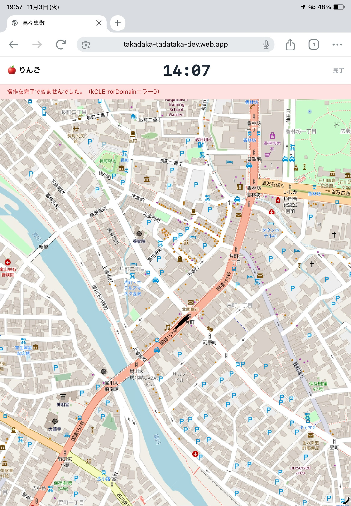

# #48 `kCLErrorDomainエラー-0` の原因調査

## 結論

今回のエラーは、地図表示やFirebase通信の失敗ではなく、iOSの位置情報基盤（Core Location）がその時点で有効な測位結果を取得できなかったことが原因です。

スクリーンショットに表示されている次のエラーが根拠です。

```text
操作を完了できませんでした。(kCLErrorDomainエラー-0)
```

`kCLErrorDomain` のコード `0` は `kCLErrorLocationUnknown` に対応します。Appleの説明では「位置情報マネージャーが現在、位置情報を取得できなかった」ことを示す一時的な測位エラーです。位置情報の利用拒否を示すコード `1` (`kCLErrorDenied`) とは異なります。

参考: [Apple Developer Documentation: kCLErrorLocationUnknown](https://developer.apple.com/documentation/corelocation/clerror-swift.struct/code/locationunknown?language=objc)

## スクリーンショットから確認できること



- iPhoneのSafariで `takadaka-tadataka-dev.web.app` を開いている。
- 地図タイルは表示できているため、ページの読み込みやOpenStreetMapタイル取得は成功している。
- エラーは地図の上部に表示され、内容はCore Location由来のコード `0` である。
- したがって、少なくともこの画面だけからはFirebase、Firestore、地図タイル、ルーティングの障害とは判断できない。

## リポジトリ内の発生経路

`src/pages/Game.tsx` はゲーム開始時に `startGPS()` を呼び出します。`startGPS()` は `src/hooks/useGeolocation.ts` の `navigator.geolocation.watchPosition()` を実行します。

```ts
navigator.geolocation.watchPosition(
  (pos) => { /* 測位成功時 */ },
  (err) => setError(err.message),
  { enableHighAccuracy: true, maximumAge: 0 },
)
```

この実装では、ブラウザから返されたエラーメッセージを変換せず、`gpsError` として画面に表示しています。そのため、iOS Safariが返したネイティブの文言がそのまま「`kCLErrorDomainエラー-0`」として見えます。

また、`maximumAge: 0` によりキャッシュされた位置情報を使わず、毎回新しい測位結果を要求しています。`enableHighAccuracy: true` も指定されているため、初回測位に時間がかかる環境では、測位結果を受け取る前に一時的な `locationUnknown` が発生しやすくなります。

## 最も可能性が高い原因

1. ゲーム開始直後で、GPS/Wi-Fi/基地局による初回測位がまだ完了していない。
2. 屋内、建物の近く、地下、周囲に高い建物が多い場所などでGPS信号が弱い。
3. iPhoneの位置情報サービス、Safariのサイト別位置情報許可、または「正確な位置情報」が一時的に利用できない。
4. 一時的なネットワークまたは測位サービスの不成立。

このコードでは測位成功時に `setError(null)` を実行するため、あとから正常な位置情報が届けばエラー表示は消えます。したがって、コード `0` は「位置情報が恒久的に拒否された」という意味ではありません。

## 原因ではないもの

- `kCLErrorDomainエラー-0` はFirestoreの書き込みエラーではない。FirestoreエラーならFirebase固有のコードやメッセージになる。
- 地図タイルの取得失敗ではない。スクリーンショットでは地図が描画されている。
- 位置情報の利用拒否そのものではない。拒否の場合はCore Locationの `kCLErrorDenied`（コード `1`）が該当する。
- `MIN_ACCURACY = 30` の精度フィルタが直接の原因ではない。このフィルタは測位成功後に軌跡へ追加する点を捨てるためのもので、Core Locationのエラーコード `0` を発生させる処理ではない。

## 再現・切り分け手順

次の条件を変えて、同じ端末で確認する。

1. 屋外でページを開き、位置情報の許可を「このWebサイトの使用中は許可」または同等の設定にする。
2. 「正確な位置情報」が有効であることを確認する。
3. ゲーム開始直後に数秒から十数秒待ち、初回測位が完了するか確認する。
4. Safariを再読み込みして再度開始する。
5. iPhoneの「設定 > プライバシーとセキュリティ > 位置情報サービス」で、位置情報サービス自体が有効か確認する。
6. 同じ場所でApple Maps等が現在地を取得できるか確認する。Apple Mapsでも取得できなければ、アプリではなく端末/環境側の問題である可能性が高い。
7. Safariで別のHTTPSサイトのGeolocation APIも試し、このサイトだけで発生するか比較する。

## 今後の実装上の改善案

今回のエラーを「操作を完了できませんでした」と即時に失敗扱いするのではなく、次のように扱うとユーザーに誤解を与えにくくなります。

- `GeolocationPositionError.code` を確認し、`POSITION_UNAVAILABLE` 相当の場合は「現在地を確認中です。屋外で少し待ってください」と表示する。
- `timeout` を設定し、初回測位の待機状態と恒久的な失敗を区別する。
- `locationUnknown` 相当の一時エラーでは、監視を停止せず、次の `watchPosition` 更新を待つ。
- 拒否（`PERMISSION_DENIED`）の場合だけ、iPhone/Safariの設定変更を案内する。
- ユーザーが現在地を取得できなくても、初期地点表示やゲーム開始をどう扱うかを仕様として決める。

## 調査時点の判定

現時点で確認できる範囲では、#48の直接原因は「iOS SafariからGeolocation APIへ渡った初回または一時的な測位要求に対し、Core Locationが位置を返せなかったこと」です。端末の位置情報設定が拒否されていたと断定できる証拠はなく、スクリーンショットだけでは屋内環境・初回測位待ち・一時的な測位サービス不成立のどれかまでは特定できません。

